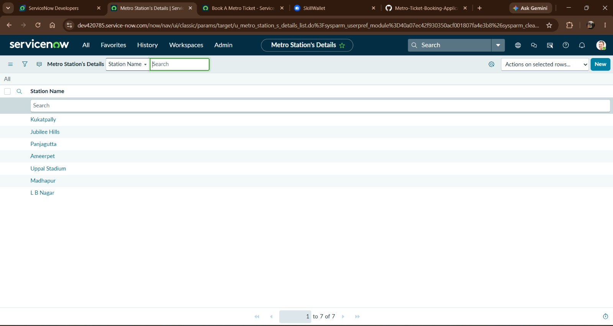
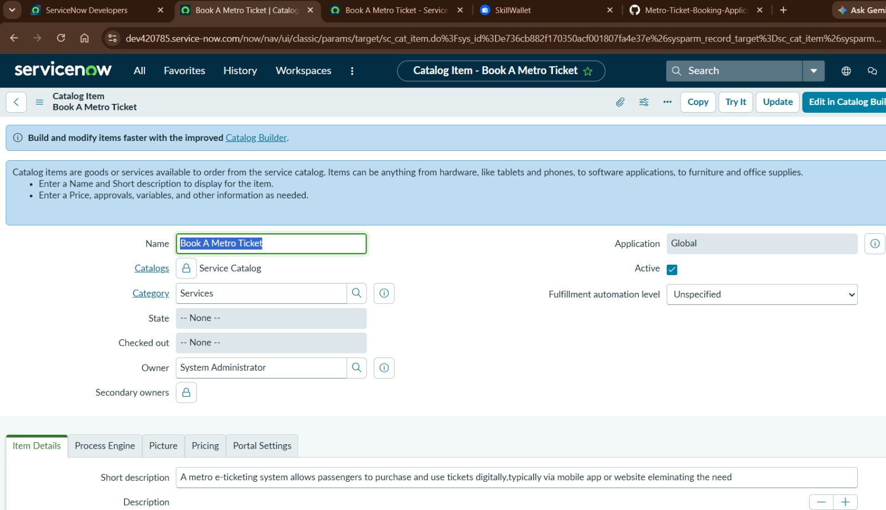
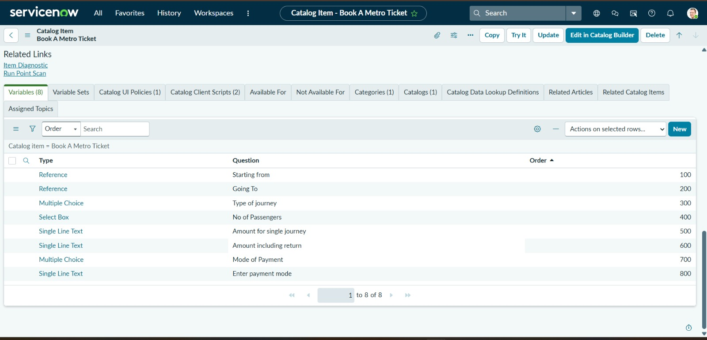
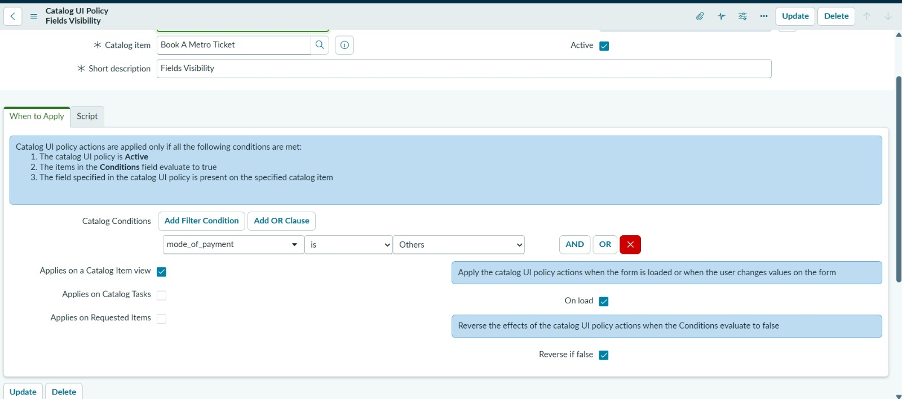
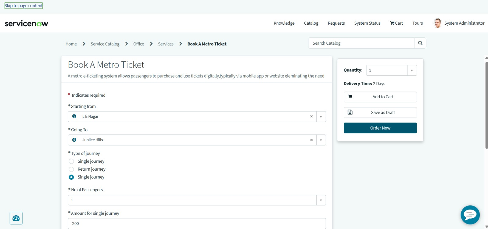
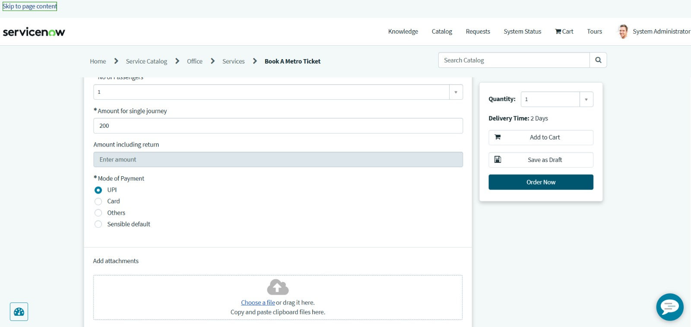
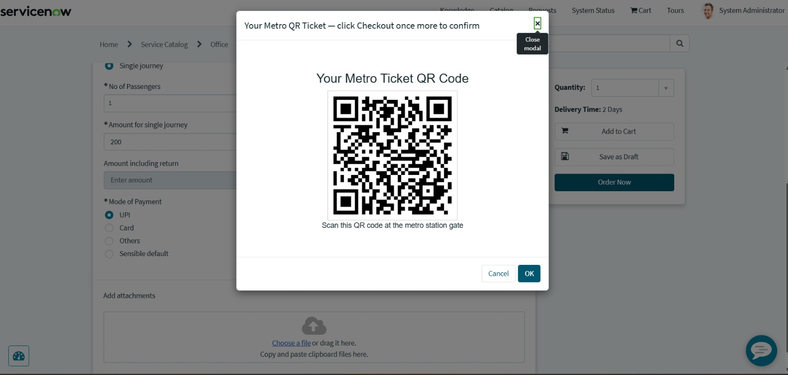
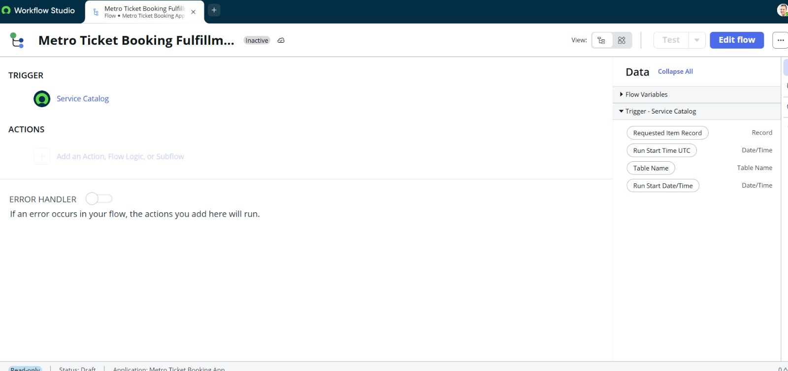

# Phase 5: Project Development Phase

## 1. Introduction

This phase describes the implementation of the Metro Ticket Booking Application using ServiceNow. The application combines a station data table, a catalog booking form, conditional form behaviour, QR-code display and configured Flow Designer automation.

## 2. Development Environment

- Platform: ServiceNow
- User interface: Service Portal
- Booking interface: Catalog item
- Automation: Flow Designer
- Version storage and documentation: GitHub

## 3. Metro Station Details Table

A custom Metro Station Details table was configured to store metro station records.

The booking form uses reference variables to let users select their starting and destination stations.

**Screenshot:** 
## 4. Book A Metro Ticket Catalog Item

The catalog item collects the information required for a booking.

The configured variables include:

- Starting From
- Going To
- Type of Journey
- No of Passengers
- Amount for Single Journey
- Amount Including Return
- Mode of Payment
- Enter Payment Mode

**Screenshots:**  and 
## 5. Conditional Payment Field

A Catalog UI Policy was configured so that selecting "Others" as the payment method makes the Enter Payment Mode field visible and mandatory.

**Screenshot:** 

## 6. Service Portal Booking Form

The Service Portal provides the interface through which users access and complete the booking form.

**Screenshots:**  and 

## 7. QR-Code Generation and Display

A catalog client script and a Service Portal widget were configured to generate a QR-code image URL and display the QR code in the booking experience.

The widget receives the QR image URL and displays it to the user.

The displayed QR code demonstrates the prototype's QR feature; real gate validation or live ticket verification is not claimed unless separately implemented.

**Screenshot:** 
## 8. Flow Designer

A Flow Designer flow was configured for the application's workflow automation.

The flow should be checked in the ServiceNow instance to verify its trigger, actions, activation status and execution results.

**Screenshot:** Insert 
## 9. Implementation Outcome

The development phase produced the station data configuration, booking form, conditional payment-field behaviour, QR-code display and configured workflow automation. The following phase documents the project report, setup instructions and testing evidence.
